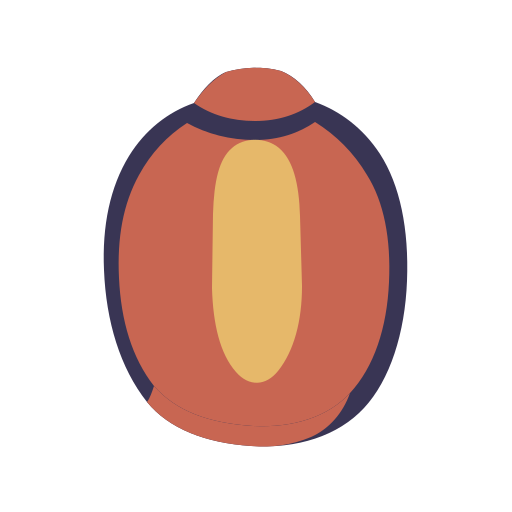

<div align="center">
  
  <h1>Marla</h1>
  <p><strong>Übersetzung direkt neben dem, was du gerade liest.</strong></p>
  <p>Eine native Übersetzungsebene für macOS, die bei Bedarf erscheint, nah am Ausgangstext bleibt und sich zurücknimmt, sobald du fertig bist.</p>
  <p>Ein kleines Licht neben der lesenden Person, das Unbekanntes sichtbar macht, ohne dich aus deiner Arbeit zu holen.</p>

  <p>
    <a href="README.zh-CN.md">简体中文</a> ·
    <a href="README.md">English</a> ·
    <a href="README.ja.md">日本語</a> ·
    <a href="README.fr.md">Français</a> ·
    <a href="README.es.md">Español</a> ·
    <a href="README.de.md">Deutsch</a> ·
    <a href="README.ko.md">한국어</a>
  </p>

  <p>
    
    
    
    
  </p>

  <p>
    <a href="website/">Marla-Präsentationsseite</a> ·
    <a href="https://github.com/Anti2077/Marla/releases/latest">Download (GitHub Releases)</a> ·
    <a href="https://github.com/Anti2077/Marla">GitHub</a>
  </p>

  <p>
    <a href="#warum-marla">Warum Marla</a> ·
    <a href="#drei-wege">Arbeitsabläufe</a> ·
    <a href="#datenschutz-ohne-ausflüchte">Datenschutz</a> ·
    <a href="#entwicklung">Entwicklung</a> ·
    <a href="docs/README.md">Dokumentation</a>
  </p>
</div>

<p align="center">
  <strong><a href="website/public/media/desktop/marla-hero-in-place--desktop-5x4.mp4">Den echten Marla-Arbeitsablauf ansehen (MP4)</a></strong>
</p>

<p align="center"><sub>Echte Aufnahme der nativen macOS-App. GitHub öffnet die MP4-Datei in seinem Medienbetrachter.</sub></p>

## Hier beginnen

Die Marla-Präsentationsseite liegt unter [`website/`](website/). Für einen Download geht es zu [GitHub Releases](https://github.com/Anti2077/Marla/releases/latest); Quellcode und Entwicklungsaufzeichnungen befinden sich im [GitHub-Repository](https://github.com/Anti2077/Marla). Das Repository befindet sich weiterhin in der Vorbereitungsphase vor einer Veröffentlichung, daher enthält die Releases-Seite möglicherweise noch keine herunterladbaren Dateien.

## Warum Marla

Die meisten Übersetzungstools werden zu einem weiteren Ziel. Marla hält die aktuelle Anwendung der nutzenden Person als wichtigste Oberfläche: per Tastenkürzel aufrufen, ein Ergebnis in der Nähe lesen, schließen und am selben Ort weiterarbeiten.

- **Bleibt am Ort.** Ergebnisse aus Auswahl und Screenshot erscheinen in einer nahegelegenen nativen Karte statt in einem zentralen Übersetzungsfenster.
- **Zeigt die Absicht sofort.** Die stabile Ergebnisoberfläche erscheint, bevor die Netzwerkantwort abgeschlossen ist, und wächst mit den gestreamten Inhalten.
- **Bewahrt Struktur.** Quick Input und unterstützte Rich-Text-Auswahlen behalten semantisches Markdown während Übersetzung und nativer Darstellung.
- **Hält Provider austauschbar.** Benannte Profile unterstützen die OpenAI-kompatible API Chat Completions, OpenAI Responses, Anthropic Messages und Google Gemini Generate Content mit ausdrücklicher Wahl von Endpunkt und Modell.

## Drei Wege

| Einstieg | Standard-Tastenkürzel | Was passiert |
| --- | --- | --- |
| **Ausgewählter Text** | `⌃⇧D` | Marla übernimmt die aktuelle Auswahl sicher und streamt ein Ergebnis neben dem Ausgangstext. |
| **Bildschirmbereich** | `⌃⇧S` | Eingefrorene Bilder aller Displays erlauben die Auswahl von Bereichen, Elementen und Fenstern. Vision-OCR ist der Standard; Cloud-GLM-OCR oder lokales Ollama `glm-ocr` können ausdrücklich gewählt werden. |
| **Quick Input** | `⌃⇧Space` | Ein kompakter Editor übersetzt eingegebenen oder eingefügten Inhalt einschließlich unterstützter Markdown-Struktur. |

**Optionales Experiment:** Die unabhängige Screenshot-Übersetzung an der ursprünglichen Position ist standardmäßig ausgeschaltet und lässt sich in den experimentellen Einstellungen aktivieren. Ihr konfigurierbares Standardkürzel ist `⌃⇧I`. Sie rekonstruiert mit Cloud-GLM-OCR zuverlässige Textblöcke ausschließlich über dem gewählten eingefrorenen Ausschnitt, bleibt im Arbeitsspeicher und lässt sich sofort schließen. Die normale Screenshot-Übersetzung verwendet weiterhin die nahegelegene Karte.

Die Tastenkürzel sind konfigurierbar. Abgeschlossene Ergebnisse unterstützen Vergleich, Kopieren, Wiederholen, Systemvorlesen, Anheften, Sprachwechsel und Provider-Wechsel, ohne Marla in einen Dokumentarbeitsbereich zu verwandeln.

## Nativ, wo es zählt

```text
Explizite Auslösung
  → Erfassung und Darstellung mit SwiftUI / AppKit
  → versionierte prozessinterne C-ABI
  → eingebetteter Rust-Kern für Provider, Streaming, Normalisierung und Abbruch
  → nahe native Ergebnisoberfläche
```

Marla ist eine macOS-App mit Swift 6, SwiftUI für dauerhafte Oberflächen und AppKit für Menüleiste, Panels, Fokus und bildschirmweite Interaktion. Der Rust-2024-Kern ist als statische Bibliothek eingebettet: Es gibt weder ein Localhost-Backend noch einen separaten dauerhaft laufenden Dienst.

## Datenschutz, ohne Ausflüchte

| Pfad | Aktuelle Grenze |
| --- | --- |
| **Auswahlübersetzung** | Nur eine ausdrücklich ausgelöste, geschützte Copy-Transaktion darf Inhalte liefern. Accessibility dient Berechtigungen und Positionierung, nicht als versteckte Textquelle. |
| **Vision-Screenshot-OCR** | Der ausgewählte Screenshot-Ausschnitt bleibt für das OCR lokal. Die Textübersetzung kann weiterhin den konfigurierten Cloud-Provider verwenden. |
| **Cloud-GLM-OCR** | Nur der gewählte Ausschnitt wird hochgeladen, nach ausdrücklicher Auswahl gemäß dem Hinweis in den Einstellungen oder beim Aufruf des aktivierten Experiments an der ursprünglichen Position. |
| **Lokales Ollama GLM-OCR** | Der gewählte Ausschnitt geht ausschließlich an den vom Nutzer verwalteten lokalen Ollama-`glm-ocr`-Dienst. Marla bündelt, installiert oder startet weder Ollama noch dessen Modell; die Textübersetzung kann weiterhin einen Cloud-Provider verwenden. |
| **Speicherung** | Screenshots und letzte Übersetzungen bleiben nur im Arbeitsspeicher; Zugangsdaten liegen im Schlüsselbund. Dauerhafter Übersetzungsverlauf und die Erfassung von Fenstertext als Kontext sind nicht implementiert. |

Marla behauptet nicht, vollständig offline zu arbeiten. Die genauen Grenzen von Provider, OCR und Daten werden bewusst sichtbar gemacht, statt sie in einem einzigen Datenschutz-Slogan zusammenzufassen.

## Unterstützte Sprachen

Marlas aktuelle Produktspracheinstellung enthält sieben Optionen:

| Sprache | Code |
| --- | --- |
| Vereinfachtes Chinesisch | `zh-Hans` |
| Englisch | `en` |
| Japanisch | `ja` |
| Französisch | `fr` |
| Spanisch | `es` |
| Deutsch | `de` |
| Koreanisch | `ko` |

Traditionelles Chinesisch wird auf die Produktoption Vereinfachtes Chinesisch normalisiert und ist keine eigene Einstellung. Provider-Dokumentation kann weitere Sprachen aufführen; Marla bezeichnet eine Sprache erst dann als vom Produkt unterstützt, wenn Erkennung, Routing, UI und Provider-Zuordnung gemeinsam verifiziert wurden.

## Projektstatus

Marla bleibt in **Inkubation / Unveröffentlicht**, während die öffentlichen Einstiegspunkte vorbereitet werden. Die native Anwendung und ihre Kernabläufe sind implementiert, aber es wurde noch kein öffentliches Release, keine Produktversion, kein notarisiertes Paket und kein Updater erklärt.

- [Verifizierter Entwicklungsstatus](docs/development/STATUS.md)
- [Produktdefinition](docs/product/PRODUCT.md)
- [Architektur](docs/architecture/ARCHITECTURE.md)
- [Paper-Lantern-Marke](docs/product/BRAND.md)
- [Marla-Präsentationsseite](website/)
- [Hinweise zur Website-Implementierung](website/README.md)

## Dank und Inspiration

Vielen Dank an das Open-Source-Projekt [Snow Shot](https://github.com/mg-chao/snow-apps). Das Einrasten an Elementen, der Wechsel zwischen über- und untergeordneten Ebenen per Mausrad, die Abfragesteuerung im Hintergrund und unterbrechbare Auswahlübergänge dienten als Vorbild für Marlas Elementauswahl bei Bildschirmaufnahmen. Die flüssige Bedienung war eine wichtige Referenz für diese Funktion.

Wir haben einen [festen Quellcode-Stand von Snow Shot](https://github.com/mg-chao/snow-apps/tree/01753292547704fd0f11c45317d2dd08cdbf03df) untersucht und die Funktion eigenständig in Swift/AppKit umgesetzt, ohne dessen Quellcode oder Abhängigkeiten zu übernehmen. Die sofortige Neuauswahl bei Zeigerbewegung, der Wechsel um nur eine Ebene pro Trackpad-Geste und die Animationsdauer wurden anhand praktischer Rückmeldungen zu Marla angepasst. Umsetzung und Prüfung sind in [TASK-054](docs/tasks/TASK-054-element-selection-motion.md) dokumentiert.

## Lizenz

Der ursprüngliche Code, die Build-Skripte, Dokumentation und ursprünglichen Projektressourcen von Marla stehen im Rahmen der Rechte des Eigentümers unter **GNU GPL ausschließlich Version 3 (`GPL-3.0-only`)**. Siehe [LICENSE](LICENSE), [COPYRIGHT](COPYRIGHT), den [zweisprachigen Leitfaden zu Lizenz und Quellcodeweitergabe](docs/development/LICENSING.md) sowie [Drittanbieterhinweise](THIRD_PARTY_NOTICES.md). Änderungen, Weitergabe und kommerzielle Nutzung sind unter den GPL-Bedingungen erlaubt; es gibt keine Beschränkung auf nichtkommerzielle Nutzung. Drittmaterial behält seine Bedingungen. Die GSAP-Abhängigkeiten der Website weisen einen ungelösten GPL-Kompatibilitätskonflikt auf; diese Lizenz lizenziert sie nicht um und erklärt den kombinierten Website-Build nicht für GPL-kompatibel.

## Entwicklung

### Voraussetzungen

- macOS 14 oder neuer auf Apple Silicon
- Xcode 26.5 oder eine kompatible vollständige Xcode-Installation
- Swift 6.2 oder neuer
- Rust 1.85 oder neuer

Vollständige Prüfung des Repositorys ausführen:

```sh
./scripts/check.sh
```

Das Skript prüft die Rust-Formatierung, baut und testet den Rust-Kern und die Swift-Schicht, baut die native Debug-App gegen die Cargo-Debug-Bibliothek, prüft die Projektstruktur und kontrolliert den Diff. Die vollständige Xcode-Installation wird nur für die eigenen Befehle ausgewählt; die systemweite `xcode-select`-Einstellung bleibt unverändert.

Die festgelegte, stabil signierte Release-Entwicklungs-App bauen:

```sh
./scripts/build-test-app.sh
```

Das verifizierte Artefakt wird unter `artifacts/Marla_dev.app` mit der ausschließlich für die Entwicklung vorgesehenen Marketing Version `0.0.0` geschrieben. Dieser numerische Wert ist Bundle-Metadaten und keine öffentliche Release-Version.

<details>
<summary><strong>Erster lokal signierter Build</strong></summary>

Das Packaging-Skript benötigt eine stabile lokale Codesignatur-Identität und fällt niemals stillschweigend auf Ad-hoc-Signierung zurück. Übergib den Identitätsnamen oder den von `security find-identity -v -p codesigning` gemeldeten Zertifikats-Hash:

```sh
MARLA_CODE_SIGN_IDENTITY="Your Local Code Signing Identity" \
./scripts/build-test-app.sh
```

Spätere Builds ohne Argumente übernehmen den Zertifikats-Hash aus der vorhandenen festen App und prüfen vor dem Ersetzen, dass ihre Designated Requirement stabil bleibt. Das dient nur lokalen Tests; es stellt keine Developer-ID-Verteilung, Notarisierung oder automatische TCC-Genehmigung bereit.

</details>

### Repository-Übersicht

| Pfad | Aufgabe |
| --- | --- |
| `Sources/MarlaApp/` | SwiftUI/AppKit-Anwendung, Erfassung, Einstellungen, Sitzungen und Darstellung |
| `Sources/MarlaCore/` | Swift-Brückenmodelle und Provider-Verträge |
| `Sources/MarlaRustFFI/` | Versionierte C-Brücke zwischen Swift und Rust |
| `rust/marla-core/` | Eingebetteter Provider-, Streaming-, OCR-Normalisierungs- und Abbruchkern |
| `website/` | Unabhängiger React/Vite-Prototyp der Produkt-Präsentationsseite |
| `docs/` | Produktwahrheit, Architektur, Tasks, Status und Verifikationsergebnisse |
| `scripts/` | Repository-Prüfungen, Packaging und Artefaktverifikation |

Lies vor Änderungen die [Dokumentationsübersicht](docs/README.md), den [aktuellen Status](docs/development/STATUS.md) und den deiner Unterhaltung bzw. deinem Arbeitsbaum ausdrücklich zugewiesenen Task. Das Repository trennt Produktideen, bestätigte Vorhaben, aktive Implementierung und verifizierte Nachweise.

---

<p align="center"><sub>Paper Lantern: ein kleines Licht neben der lesenden Person.</sub></p>
