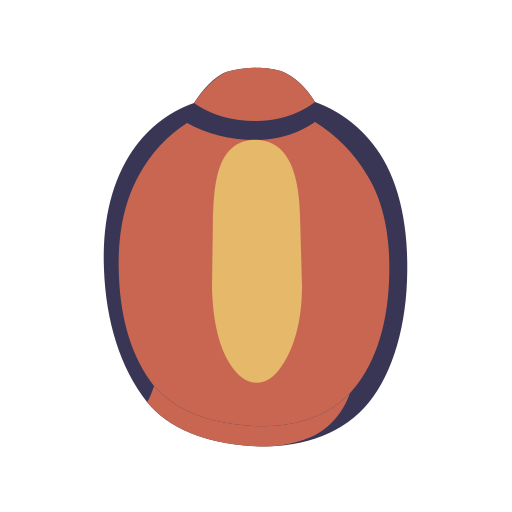

<div align="center">
  
  <h1>Marla</h1>
  <p><strong>Traducción que permanece junto a lo que estás leyendo.</strong></p>
  <p>Una capa de traducción nativa para macOS que aparece cuando la necesitas, permanece cerca del texto original y desaparece cuando terminas.</p>
  <p>Una pequeña luz junto al lector para revelar el idioma desconocido sin apartarte de tu trabajo.</p>

  <p>
    <a href="README.md">简体中文</a> ·
    <a href="README.en.md">English</a> ·
    <a href="README.ja.md">日本語</a> ·
    <a href="README.fr.md">Français</a> ·
    <a href="README.es.md">Español</a> ·
    <a href="README.de.md">Deutsch</a> ·
    <a href="README.ko.md">한국어</a>
  </p>

  <p>
    
    
    
    
  </p>

  <p>
    <a href="website/">Página de presentación de Marla</a> ·
    <a href="https://github.com/Anti2077/Marla/releases/latest">Descargar (GitHub Releases)</a> ·
    <a href="https://github.com/Anti2077/Marla">GitHub</a>
  </p>

  <p>
    <a href="#por-que-marla">Por qué Marla</a> ·
    <a href="#tres-formas-de-empezar">Flujos de trabajo</a> ·
    <a href="#privacidad-sin-generalidades">Privacidad</a> ·
    <a href="#desarrollo">Desarrollo</a> ·
    <a href="docs/README.md">Documentación</a>
  </p>
</div>

<p align="center">
  <strong><a href="website/public/media/desktop/marla-hero-in-place--desktop-5x4.mp4">Ver el flujo real de Marla (MP4)</a></strong>
</p>

<p align="center"><sub>Captura real de la aplicación nativa para macOS. GitHub abre el MP4 en su visor multimedia.</sub></p>

## Empieza aquí

La página de presentación de Marla está en [`website/`](website/); para preparar una descarga, visita [GitHub Releases](https://github.com/Anti2077/Marla/releases/latest). El código fuente y los registros de desarrollo están en el [repositorio de GitHub](https://github.com/Anti2077/Marla). El repositorio todavía está en la fase de preparación previa al lanzamiento, por lo que la página de Releases puede no tener aún archivos descargables.

## Por qué Marla

La mayoría de las herramientas de traducción se convierten en otro destino. Marla mantiene la aplicación actual del usuario como superficie principal: actívala con un atajo, lee un resultado cercano, ciérralo y continúa desde el mismo lugar.

- **Permanece en su sitio.** Los resultados de selección y captura de pantalla aparecen en una tarjeta nativa cercana, no en una ventana principal de traducción.
- **Muestra la intención de inmediato.** La superficie de resultados estable aparece antes de que termine la respuesta de red y crece a medida que llega el contenido transmitido.
- **Conserva la estructura.** Quick Input y las selecciones enriquecidas compatibles mantienen Markdown semántico durante la traducción y la representación nativa.
- **Mantiene los proveedores sustituibles.** Los perfiles con nombre compatibles con OpenAI hacen explícitos el endpoint de traducción de texto y el modelo elegidos por el usuario.

## Tres formas de empezar

| Entrada | Atajo predeterminado | Qué sucede |
| --- | --- | --- |
| **Texto seleccionado** | `⌃⇧D` | Marla obtiene de forma segura la selección actual y transmite un resultado junto al texto original. |
| **Región de la pantalla** | `⌃⇧S` | Un fotograma congelado de varias pantallas permite seleccionar una región, usar OCR local de Vision y elegir explícitamente la opción GLM-OCR. |
| **Quick Input** | `⌃⇧Space` | Un editor compacto traduce contenido escrito o pegado, incluida la estructura Markdown compatible. |

Los atajos se pueden configurar. Los resultados completados permiten comparar, copiar, reintentar, usar la voz del sistema, fijar, cambiar de idioma y cambiar de proveedor sin convertir Marla en un espacio de trabajo documental.

## Nativa donde importa

```text
Activación explícita
  → adquisición y presentación con SwiftUI / AppKit
  → ABI C en proceso y versionada
  → núcleo Rust integrado para proveedores, transmisión, normalización y cancelación
  → superficie nativa de resultados cercana
```

Marla es una aplicación de macOS escrita con Swift 6, con SwiftUI para las superficies duraderas y AppKit para la integración con la barra de menús, los paneles, el foco y la interacción a nivel de pantalla. El núcleo Rust 2024 está integrado como biblioteca estática: no existe un backend local ni un servicio independiente que permanezca siempre en ejecución.

## Privacidad, sin generalidades

| Ruta | Límite actual |
| --- | --- |
| **Traducción de selección** | Solo una transacción Copy protegida y activada explícitamente puede proporcionar contenido. Accessibility se usa para permisos y posicionamiento, no como fuente de texto oculta. |
| **OCR de capturas con Vision** | El recorte de captura seleccionado permanece local para el OCR. La traducción del texto aún puede usar el proveedor en la nube configurado. |
| **GLM-OCR** | Los píxeles de la captura solo se cargan cuando el usuario selecciona explícitamente GLM-OCR bajo la información mostrada en Settings. |
| **Almacenamiento** | Las capturas y las traducciones recientes solo duran durante la sesión. El historial de traducciones persistente y la recopilación de texto de ventanas contextuales no están implementados. |

Marla no afirma funcionar completamente sin conexión. Los límites exactos de proveedor, OCR y datos se muestran de forma deliberada en lugar de resumirse en un único lema de privacidad.

## Idiomas compatibles

El conjunto actual de idiomas del producto Marla contiene siete opciones:

| Idioma | Código |
| --- | --- |
| Chino simplificado / Simplified Chinese | `zh-Hans` |
| Inglés / English | `en` |
| Japonés / Japanese | `ja` |
| Francés / French | `fr` |
| Español / Spanish | `es` |
| Alemán / German | `de` |
| Coreano / Korean | `ko` |

El chino tradicional se normaliza a la opción de producto chino simplificado y no es una preferencia independiente. La documentación de los proveedores puede enumerar más idiomas; Marla no afirma que sean compatibles con el producto hasta verificar conjuntamente la detección, el enrutamiento, la interfaz y la correspondencia con el proveedor.

## Estado del proyecto

Marla continúa en **Incubación / Sin publicar** mientras se preparan sus puntos de entrada públicos. La aplicación nativa y sus flujos principales están implementados, pero todavía no se ha declarado ningún Release público, versión de producto asignada, paquete notarizado, actualizador ni licencia pública elegida.

- [Estado de desarrollo verificado](docs/development/STATUS.md)
- [Definición del producto](docs/product/PRODUCT.md)
- [Arquitectura](docs/architecture/ARCHITECTURE.md)
- [Marca Paper Lantern](docs/product/BRAND.md)
- [Página de presentación de Marla](website/)
- [Notas de implementación del sitio web](website/README.md)

## Desarrollo

### Requisitos previos

- macOS 14 o posterior en Apple Silicon
- Xcode 26.5 o una instalación completa de Xcode compatible
- Swift 6.2 o posterior
- Rust 1.85 o posterior

Ejecuta la comprobación completa del repositorio:

```sh
./scripts/check.sh
```

El script formatea, compila y prueba el núcleo Rust y la capa Swift, compila la aplicación nativa Debug contra la biblioteca Cargo de depuración, valida la estructura del proyecto y comprueba el diff. Selecciona la instalación completa de Xcode solo para sus propios comandos y no modifica el `xcode-select` del sistema.

Construye la aplicación de desarrollo Release con firma estable en la ruta fija:

```sh
./scripts/build-test-app.sh
```

El artefacto verificado se escribe en `artifacts/Marla_dev.app` con la Marketing Version de desarrollo `0.0.0`, destinada únicamente al desarrollo. Este valor numérico es metadato del bundle, no una versión pública.

<details>
<summary><strong>Primera compilación local firmada</strong></summary>

El script de empaquetado requiere una identidad local estable para firmar código y nunca recurre silenciosamente a una firma ad hoc. Pasa el nombre de la identidad o el hash del certificado mostrado por `security find-identity -v -p codesigning`:

```sh
MARLA_CODE_SIGN_IDENTITY="Your Local Code Signing Identity" \
./scripts/build-test-app.sh
```

Las compilaciones posteriores sin argumentos recuperan el hash del certificado desde la aplicación fija existente y verifican que su requisito designado permanezca estable antes de reemplazarla. Esto solo sirve para pruebas locales; no proporciona distribución mediante Developer ID, notarización ni aprobación automática de TCC.

</details>

### Mapa del repositorio

| Ruta | Función |
| --- | --- |
| `Sources/MarlaApp/` | Aplicación SwiftUI/AppKit, adquisición, ajustes, sesiones y presentación |
| `Sources/MarlaCore/` | Modelos del puente Swift y contratos de proveedores |
| `Sources/MarlaRustFFI/` | Puente C versionado entre Swift y Rust |
| `rust/marla-core/` | Núcleo integrado de proveedores, transmisión, normalización de OCR y cancelación |
| `website/` | Prototipo independiente de la página de presentación de producto React/Vite |
| `docs/` | Verdad del producto, arquitectura, Tasks, estado y evidencias de verificación |
| `scripts/` | Comprobaciones del repositorio, empaquetado y verificación de artefactos |

Empieza por el [mapa de documentación](docs/README.md), después lee el [estado actual](docs/development/STATUS.md) y su Task activa antes de hacer cambios. El repositorio mantiene deliberadamente separadas las ideas de producto, el backlog confirmado, la implementación activa y las evidencias verificadas.

---

<p align="center"><sub>Paper Lantern: una pequeña luz junto al lector.</sub></p>
