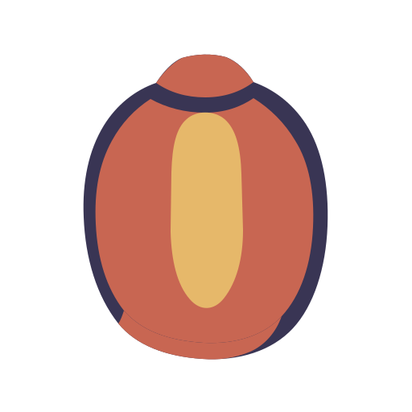

<div align="center">
  
  <h1>Marla</h1>
  <p><strong>La traduction qui reste à côté de ce que vous lisez.</strong></p>
  <p>Une couche de traduction native pour macOS, qui apparaît à votre demande, reste près du contenu source et sait se faire discrète.</p>
  <p>Éclairez la traduction à côté du texte source, lisez-la, puis reprenez votre travail sans changer de contexte.</p>

  <p>
    <a href="README.zh-CN.md">简体中文</a> ·
    <a href="README.md">English</a> ·
    <a href="README.ja.md">日本語</a> ·
    <a href="README.fr.md">Français</a> ·
    <a href="README.es.md">Español</a> ·
    <a href="README.de.md">Deutsch</a> ·
    <a href="README.ko.md">한국어</a>
  </p>

  <p>
    
    
    
    
  </p>

  <p>
    <a href="website/">Page de présentation de Marla</a> ·
    <a href="https://github.com/Anti2077/Marla/releases/latest">Télécharger (GitHub Releases)</a> ·
    <a href="https://github.com/Anti2077/Marla">GitHub</a>
  </p>

  <p>
    <a href="#pourquoi-marla">Pourquoi Marla</a> ·
    <a href="#trois-modes-dentrée">Parcours</a> ·
    <a href="#une-confidentialité-sans-formule-vague">Confidentialité</a> ·
    <a href="#développement">Développement</a> ·
    <a href="docs/README.md">Documentation</a>
  </p>
</div>

<p align="center">
  <strong><a href="website/public/media/desktop/marla-hero-in-place--desktop-5x4.mp4">Voir le véritable parcours Marla (MP4)</a></strong>
</p>

<p align="center"><sub>Capture réelle de l'application native macOS. GitHub ouvre le MP4 dans son lecteur multimédia.</sub></p>

## Pour commencer

La page de présentation de Marla se trouve dans [`website/`](website/). Pour télécharger l'application, rendez-vous sur [GitHub Releases](https://github.com/Anti2077/Marla/releases/latest) ; le code source et les journaux de développement sont disponibles dans le [dépôt GitHub](https://github.com/Anti2077/Marla). Le dépôt est encore en préparation avant publication, il est donc possible que la page Releases ne contienne pas encore de fichier à télécharger.

## Pourquoi Marla

La plupart des outils de traduction deviennent une destination supplémentaire. Marla garde l'application en cours d'utilisation comme surface principale : invoquez la traduction avec un raccourci, lisez le résultat à proximité, fermez-le et reprenez votre travail au même endroit.

- **Reste sur place.** Les résultats d'une sélection ou d'une capture d'écran apparaissent dans une fiche native à proximité, et non dans une fenêtre de traduction principale.
- **Montre immédiatement votre intention.** La surface stable du résultat apparaît avant la réponse réseau et grandit avec le contenu reçu en streaming.
- **Préserve la structure.** Quick Input et les sélections enrichies prises en charge conservent le Markdown sémantique pendant la traduction et le rendu natif.
- **Permet de remplacer les fournisseurs.** Les profils nommés prennent en charge Chat Completions compatible avec OpenAI, OpenAI Responses, Anthropic Messages et Google Gemini Generate Content, avec un choix explicite du point de terminaison et du modèle.

## Trois modes d'entrée

| Entrée | Raccourci par défaut | Fonctionnement |
| --- | --- | --- |
| **Texte sélectionné** | `⌃⇧D` | Marla récupère la sélection actuelle de manière protégée et affiche le résultat en streaming à côté du contenu source. |
| **Zone de l’écran** | `⌃⇧S` | Les images figées de chaque écran permettent de sélectionner une zone, un élément ou une fenêtre. Vision OCR est le choix par défaut ; GLM-OCR dans le cloud ou Ollama `glm-ocr` en local peuvent être sélectionnés explicitement. |
| **Quick Input** | `⌃⇧Space` | Un éditeur compact traduit le contenu saisi ou collé, y compris les structures Markdown prises en charge. |

**Expérience facultative :** La traduction indépendante sur place d’une capture est désactivée par défaut et peut être activée dans les réglages expérimentaux. Son raccourci par défaut, modifiable, est `⌃⇧I`. Elle utilise GLM-OCR dans le cloud pour reconstruire les blocs de texte fiables uniquement sur la zone figée sélectionnée, reste en mémoire et peut être fermée immédiatement. La traduction ordinaire des captures conserve la fiche à proximité.

Les raccourcis sont configurables. Une fois terminés, les résultats prennent en charge la comparaison, la copie, une nouvelle tentative, la lecture vocale du système, l'épinglage, le changement de langue et le changement de fournisseur, sans transformer Marla en espace de travail documentaire.

## Natif là où cela compte

```text
Déclenchement explicite
  → acquisition et présentation avec SwiftUI / AppKit
  → ABI C versionnée dans le même processus
  → cœur Rust intégré pour les fournisseurs, le streaming, la normalisation et l'annulation
  → surface de résultat native à proximité
```

Marla est une application macOS écrite en Swift 6. SwiftUI gère les surfaces durables, tandis qu'AppKit prend en charge la barre des menus, les panneaux, le focus et les interactions au niveau de l'écran. Le cœur Rust 2024 est intégré sous forme de bibliothèque statique : il n'existe ni serveur localhost ni service séparé fonctionnant en permanence.

## Une confidentialité sans formule vague

| Parcours | Limite actuelle |
| --- | --- |
| **Traduction d'une sélection** | Seule une transaction Copy protégée et déclenchée explicitement peut fournir du contenu. Accessibility sert aux autorisations et au positionnement, jamais de source de texte cachée. |
| **OCR de capture avec Vision** | La zone de capture sélectionnée reste locale pour l'OCR. La traduction du texte peut toutefois utiliser le fournisseur cloud configuré. |
| **GLM-OCR dans le cloud** | Seule la zone sélectionnée est téléversée, après un choix explicite suivant l’information des réglages, ou lorsque l’utilisateur invoque l’expérience sur place activée. |
| **Ollama GLM-OCR en local** | La zone sélectionnée est envoyée uniquement au service local Ollama `glm-ocr` géré par l’utilisateur. Marla ne fournit, n’installe ni ne lance Ollama ou son modèle ; la traduction du texte peut encore utiliser un fournisseur cloud. |
| **Stockage** | Les captures et les traductions récentes restent uniquement en mémoire ; les identifiants sont stockés dans le trousseau. L’historique persistant et la collecte de texte contextuel des fenêtres ne sont pas implémentés. |

Marla ne prétend pas fonctionner entièrement hors ligne. Les limites précises concernant le fournisseur, l'OCR et les données sont volontairement visibles au lieu d'être regroupées sous un slogan unique sur la confidentialité.

## Langues prises en charge

L'ensemble actuel des langues du produit Marla comprend sept options :

| Langue | Code |
| --- | --- |
| Chinois simplifié | `zh-Hans` |
| Anglais | `en` |
| Japonais | `ja` |
| Français | `fr` |
| Espagnol | `es` |
| Allemand | `de` |
| Coréen | `ko` |

Le chinois traditionnel est normalisé vers l'option de chinois simplifié et ne constitue pas une préférence distincte. La documentation des fournisseurs peut mentionner davantage de langues ; Marla ne les déclare pas prises en charge par le produit tant que la détection, le routage, l'interface et la correspondance avec les fournisseurs n'ont pas été vérifiés ensemble.

## État du projet

Marla reste en phase **Incubation / Non publié** pendant la préparation de ses points d'accès publics. L'application native et ses parcours principaux sont implémentés, mais aucune Release publique, version produit attribuée, archive notariée ou fonction de mise à jour n'a encore été déclarée.

- [État de développement vérifié](docs/development/STATUS.md)
- [Définition du produit](docs/product/PRODUCT.md)
- [Architecture](docs/architecture/ARCHITECTURE.md)
- [Identité Paper Lantern](docs/product/BRAND.md)
- [Page de présentation de Marla](website/)
- [Notes d'implémentation du site](website/README.md)

## Remerciements et inspirations

Merci au projet open source [Snow Shot](https://github.com/mg-chao/snow-apps). L’accrochage aux éléments, la navigation entre niveaux parents et enfants à la molette, la gestion des requêtes en arrière-plan et les transitions de sélection interruptibles ont inspiré la sélection d’éléments de capture de Marla. La fluidité de ses interactions a été une référence importante pour cette fonctionnalité.

Nous avons étudié une [révision précise du code de Snow Shot](https://github.com/mg-chao/snow-apps/tree/01753292547704fd0f11c45317d2dd08cdbf03df) et réalisé une implémentation indépendante en Swift/AppKit, sans importer son code ni ses dépendances. La sélection immédiate au déplacement du pointeur, le passage d’un seul niveau par geste du trackpad et la durée des animations ont été ajustés selon les retours d’utilisation sur Marla. Voir [TASK-054](docs/tasks/TASK-054-element-selection-motion.md) pour les détails d’implémentation et de vérification.

## Licence

Le code original, les scripts de compilation, la documentation et les ressources originales de Marla sont proposés sous **GNU GPL version 3 uniquement (`GPL-3.0-only`)**, dans la limite des droits du propriétaire. Voir [LICENSE](LICENSE), [COPYRIGHT](COPYRIGHT), le [guide bilingue de licence et de distribution des sources](docs/development/LICENSING.md) et les [mentions tierces](THIRD_PARTY_NOTICES.md). Modification, redistribution et utilisation commerciale sont autorisées selon la GPL, sans restriction non commerciale. Les éléments tiers conservent leurs conditions. Les dépendances GSAP du site présentent un conflit de compatibilité GPL non résolu ; cette licence ne les remplace pas et ne déclare pas la compilation combinée du site compatible GPL.

## Développement

### Prérequis

- macOS 14 ou version ultérieure sur Apple Silicon
- Xcode 26.5 ou une installation complète et compatible de Xcode
- Swift 6.2 ou version ultérieure
- Rust 1.85 ou version ultérieure

Exécutez la vérification complète du dépôt :

```sh
./scripts/check.sh
```

Ce script vérifie le formatage Rust, compile et teste le cœur Rust et la couche Swift, compile l'application native Debug avec la bibliothèque de débogage Cargo, valide la structure du projet et vérifie le diff. Il sélectionne l'installation complète de Xcode uniquement pour ses propres commandes et ne modifie pas le réglage `xcode-select` de la machine.

Compilez l'application de développement Release, signée de manière stable et écrite à un emplacement fixe :

```sh
./scripts/build-test-app.sh
```

L'artefact vérifié est écrit dans `artifacts/Marla_dev.app` avec la Marketing Version de développement `0.0.0`. Cette valeur numérique est une métadonnée du paquet et non une version publique du produit.

<details>
<summary><strong>Première compilation locale signée</strong></summary>

Le script d'empaquetage exige une identité locale stable de signature de code et ne bascule jamais silencieusement vers une signature ad hoc. Indiquez un nom d'identité ou l'empreinte d'un certificat affiché par `security find-identity -v -p codesigning` :

```sh
MARLA_CODE_SIGN_IDENTITY="Your Local Code Signing Identity" \
./scripts/build-test-app.sh
```

Les compilations ultérieures sans argument récupèrent l'empreinte du certificat depuis l'application fixe existante et vérifient que son designated requirement reste stable avant de la remplacer. Cela sert uniquement aux tests locaux et ne fournit ni distribution Developer ID, ni notarisation, ni approbation TCC automatique.

</details>

### Organisation du dépôt

| Chemin | Rôle |
| --- | --- |
| `Sources/MarlaApp/` | Application SwiftUI/AppKit, acquisition, réglages, sessions et présentation |
| `Sources/MarlaCore/` | Modèles de pont destinés à Swift et contrats des fournisseurs |
| `Sources/MarlaRustFFI/` | Pont C versionné entre Swift et Rust |
| `rust/marla-core/` | Cœur intégré pour les fournisseurs, le streaming, la normalisation OCR et l'annulation |
| `website/` | Prototype indépendant de page produit en React/Vite |
| `docs/` | Vérité produit, architecture, Tasks, état et preuves de vérification |
| `scripts/` | Vérifications du dépôt, empaquetage et validation des artefacts |

Avant toute modification, consultez le [plan de la documentation](docs/README.md), l’[état actuel](docs/development/STATUS.md) et la Task explicitement attribuée à votre conversation ou arbre de travail. Le dépôt sépare les idées produit, les travaux confirmés, l’implémentation active et les preuves vérifiées.

---

<p align="center"><sub>Paper Lantern : une petite lumière à côté du lecteur.</sub></p>
