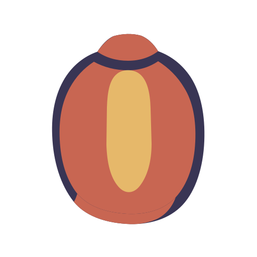

<div align="center">
  
  <h1>Marla</h1>
  <p><strong>지금 읽고 있는 곁에 머무는 번역.</strong></p>
  <p>필요할 때 나타나고 원문 가까이에 머물며, 다 읽으면 사라지는 macOS 네이티브 번역 레이어입니다.</p>
  <p>읽는 사람 곁에서 낯선 언어를 밝혀 주되, 지금 하던 작업을 빼앗지 않는 작은 빛입니다.</p>

  <p>
    <a href="README.zh-CN.md">简体中文</a> ·
    <a href="README.md">English</a> ·
    <a href="README.ja.md">日本語</a> ·
    <a href="README.fr.md">Français</a> ·
    <a href="README.es.md">Español</a> ·
    <a href="README.de.md">Deutsch</a> ·
    <a href="README.ko.md">한국어</a>
  </p>

  <p>
    
    
    
    
  </p>

  <p>
    <a href="website/">Marla 소개 홈페이지</a> ·
    <a href="https://github.com/Anti2077/Marla/releases/latest">다운로드 (GitHub Releases)</a> ·
    <a href="https://github.com/Anti2077/Marla">GitHub</a>
  </p>

  <p>
    <a href="#marla가-필요한-이유">Marla가 필요한 이유</a> ·
    <a href="#세-가지-진입-방법">워크플로</a> ·
    <a href="#과장-없는-개인정보-경계">개인정보</a> ·
    <a href="#개발">개발</a> ·
    <a href="docs/README.md">문서</a>
  </p>
</div>

<p align="center">
  <strong><a href="website/public/media/desktop/marla-hero-in-place--desktop-5x4.mp4">실제 Marla 워크플로 보기 (MP4)</a></strong>
</p>

<p align="center"><sub>macOS 네이티브 앱을 실제로 캡처한 영상입니다. GitHub는 MP4를 미디어 뷰어에서 엽니다.</sub></p>

## 먼저 보기

Marla 소개 홈페이지는 [`website/`](website/)에 있습니다. 다운로드를 준비할 때는 [GitHub Releases](https://github.com/Anti2077/Marla/releases/latest)로 이동하고, 소스 코드와 개발 기록은 [GitHub 저장소](https://github.com/Anti2077/Marla)에서 확인할 수 있습니다. 현재 저장소는 아직 출시 전 준비 단계이므로 Releases 페이지에 다운로드 가능한 파일이 없을 수 있습니다.

## Marla가 필요한 이유

대부분의 번역 도구는 또 하나의 목적지가 됩니다. Marla는 사용자가 현재 사용 중인 앱을 기본 화면으로 유지합니다. 단축키로 호출하고, 가까이에 나타난 결과를 읽고, 닫은 다음 같은 자리에서 계속 작업할 수 있습니다.

- **원래 자리에서 작동합니다.** 선택 영역과 스크린샷 결과는 별도의 메인 번역 창이 아니라 원문 가까이에 있는 네이티브 카드로 나타납니다.
- **의도를 즉시 보여 줍니다.** 네트워크 응답이 끝나기 전에 안정적인 결과 화면이 먼저 나타나고, 스트리밍되는 내용에 맞춰 커집니다.
- **구조를 보존합니다.** Quick Input과 지원되는 서식 있는 선택 영역은 번역과 네이티브 렌더링 과정에서 의미 있는 Markdown 구조를 유지합니다.
- **번역 서비스를 교체할 수 있습니다.** 이름이 지정된 프로필은 OpenAI 호환 Chat Completions, OpenAI Responses, Anthropic Messages, Google Gemini Generate Content를 지원하며 엔드포인트와 모델을 명시적으로 선택할 수 있습니다.

## 세 가지 진입 방법

| 진입 방법 | 기본 단축키 | 동작 |
| --- | --- | --- |
| **선택한 텍스트** | `⌃⇧D` | Marla가 현재 선택 영역을 안전하게 가져와 원문 옆에서 결과를 스트리밍합니다. |
| **화면 영역** | `⌃⇧S` | 각 디스플레이의 정지 화면에서 영역, 요소, 창을 선택할 수 있습니다. 기본값은 Vision OCR이며 클라우드 GLM-OCR 또는 로컬 Ollama `glm-ocr`를 명시적으로 선택할 수 있습니다. |
| **Quick Input** | `⌃⇧Space` | 작은 편집기에서 입력하거나 붙여 넣은 내용을 번역하며, 지원되는 Markdown 구조도 포함합니다. |

**선택적 실험 기능:** 독립적인 스크린샷 원위치 번역은 기본적으로 꺼져 있으며 실험 기능 설정에서 켤 수 있습니다. 변경 가능한 기본 단축키는 `⌃⇧I`입니다. 클라우드 GLM-OCR로 선택한 정지 화면 영역 위에 신뢰할 수 있는 텍스트 블록만 재구성하며, 메모리에만 보관하고 즉시 닫을 수 있습니다. 일반 스크린샷 번역은 계속 원문 가까이의 카드를 사용합니다.

단축키는 설정에서 바꿀 수 있습니다. 완료된 결과에서는 비교, 복사, 재시도, 시스템 음성 읽기, 고정, 언어 변경, Provider 변경을 지원하지만 Marla를 문서 작업 공간으로 만들지는 않습니다.

## 중요한 곳은 네이티브로

```text
명시적인 호출
  → SwiftUI / AppKit 기반 수집 및 표시
  → 버전이 지정된 프로세스 내부 C ABI
  → Provider, 스트리밍, 정규화, 취소를 담당하는 임베디드 Rust 코어
  → 원문 가까이의 네이티브 결과 화면
```

Marla는 Swift 6으로 만든 macOS 앱입니다. 지속적으로 사용하는 화면에는 SwiftUI를, 메뉴 막대, 패널, 포커스, 화면 수준 상호작용에는 AppKit을 사용합니다. Rust 2024 코어는 정적 라이브러리로 임베드되어 있으므로 localhost 백엔드나 별도로 계속 실행되는 서비스가 없습니다.

## 과장 없는 개인정보 경계

| 경로 | 현재 경계 |
| --- | --- |
| **선택 영역 번역** | 사용자가 명시적으로 호출한 보호된 Copy 트랜잭션만 콘텐츠를 제공할 수 있습니다. Accessibility는 권한과 위치 지정에 사용하며, 숨겨진 텍스트 소스로 사용하지 않습니다. |
| **Vision 스크린샷 OCR** | 선택한 스크린샷 잘라내기 영역은 OCR을 위해 로컬에 남습니다. 텍스트 번역은 설정된 클라우드 Provider를 사용할 수 있습니다. |
| **클라우드 GLM-OCR** | 설정의 안내에 따라 명시적으로 선택하거나, 켜 둔 원위치 실험 기능을 사용자가 호출한 경우에만 선택 영역을 업로드합니다. |
| **로컬 Ollama GLM-OCR** | 선택 영역은 사용자가 관리하는 로컬 Ollama `glm-ocr` 서비스에만 전송합니다. Marla는 Ollama나 모델을 포함·설치·실행하지 않으며, 텍스트 번역은 여전히 클라우드 서비스를 사용할 수 있습니다. |
| **저장** | 스크린샷과 최근 번역은 메모리에만 보관하며 자격 증명은 키체인에 저장합니다. 지속적인 번역 기록과 문맥을 위한 창 텍스트 수집은 구현되어 있지 않습니다. |

Marla는 완전한 오프라인 작동을 주장하지 않습니다. Provider, OCR, 데이터의 정확한 경계를 하나의 개인정보 문구로 뭉뚱그리지 않고 의도적으로 드러냅니다.

## 지원 언어

현재 Marla 제품 언어 집합에는 다음 일곱 가지 옵션이 있습니다.

| 언어 | 코드 |
| --- | --- |
| 중국어 간체 | `zh-Hans` |
| 영어 | `en` |
| 일본어 | `ja` |
| 프랑스어 | `fr` |
| 스페인어 | `es` |
| 독일어 | `de` |
| 한국어 | `ko` |

중국어 번체는 중국어 간체 제품 옵션으로 정규화되며 별도 환경설정 항목이 아닙니다. Provider 문서에는 더 많은 언어가 나올 수 있지만, 감지, 라우팅, UI, Provider 매핑을 함께 검증하기 전까지 Marla가 해당 언어를 제품에서 지원한다고 주장하지 않습니다.

## 프로젝트 상태

공개 진입점을 준비하는 동안 Marla는 계속 **인큐베이션 / 미출시** 상태입니다. 네이티브 앱과 핵심 워크플로는 구현되어 있지만, 공개 Release, 지정된 제품 버전, 공증된 패키지, 업데이터는 아직 선언되지 않았습니다.

- [검증된 개발 상태](docs/development/STATUS.md)
- [제품 정의](docs/product/PRODUCT.md)
- [아키텍처](docs/architecture/ARCHITECTURE.md)
- [Paper Lantern 브랜드](docs/product/BRAND.md)
- [Marla 소개 홈페이지](website/)
- [웹사이트 구현 노트](website/README.md)

## 감사와 참고한 설계

오픈 소스 프로젝트 [Snow Shot](https://github.com/mg-chao/snow-apps)에 감사드립니다. Marla의 스크린샷 요소 선택은 요소 스냅, 휠을 통한 부모·자식 계층 전환, 백그라운드 쿼리 스케줄링, 중단 가능한 선택 영역 전환 설계를 참고했습니다. 매끄러운 상호작용은 이 기능을 만드는 데 중요한 참고가 되었습니다.

[Snow Shot의 특정 소스 리비전](https://github.com/mg-chao/snow-apps/tree/01753292547704fd0f11c45317d2dd08cdbf03df)을 연구한 뒤 Swift/AppKit으로 독립 구현했으며, 소스 코드나 의존성을 가져오지 않았습니다. 포인터 이동 시 즉시 다시 선택하는 동작, 트랙패드 제스처당 한 계층 이동, 애니메이션 시간은 Marla의 실기기 사용 피드백에 맞춰 조정했습니다. 구현 및 검증 기록은 [TASK-054](docs/tasks/TASK-054-element-selection-motion.md)를 참고하세요.

## 라이선스

소유자가 허가할 권리를 가진 Marla의 원본 코드, 빌드 스크립트, 문서 및 원본 프로젝트 자산에는 **GNU GPL 버전 3만(`GPL-3.0-only`)** 적용됩니다. [LICENSE](LICENSE), [COPYRIGHT](COPYRIGHT), 중영 병기 [라이선스 및 대응 소스 배포 안내](docs/development/LICENSING.md), [제3자 고지](THIRD_PARTY_NOTICES.md)를 참조하세요. GPL 조건에 따라 수정·재배포·상업적 이용이 가능하며 비상업적 이용 제한은 없습니다. 제3자 자료에는 원래 조건이 유지됩니다. 웹사이트의 GSAP 의존성에는 해결되지 않은 GPL 호환성 문제가 있습니다. 이 허가는 해당 의존성을 재라이선스하거나 결합된 웹사이트 빌드가 GPL과 호환된다고 선언하지 않습니다.

## 개발

### 사전 요구 사항

- Apple Silicon에서 macOS 14 이상
- Xcode 26.5 또는 호환되는 전체 Xcode 설치
- Swift 6.2 이상
- Rust 1.85 이상

저장소 전체 검사를 실행합니다.

```sh
./scripts/check.sh
```

이 스크립트는 Rust 형식을 검사하고 Rust 코어와 Swift 계층을 빌드하고 테스트하며, Cargo 디버그 라이브러리를 사용해 네이티브 Debug 앱을 빌드하고, 프로젝트 구조와 diff를 검사합니다. 전체 Xcode 설치는 스크립트가 실행하는 명령에만 사용하며 시스템 전체의 `xcode-select` 설정은 바꾸지 않습니다.

고정 경로에 안정적으로 서명된 Release 개발 앱을 빌드합니다.

```sh
./scripts/build-test-app.sh
```

검증된 결과물은 개발 전용 Marketing Version `0.0.0`과 함께 `artifacts/Marla_dev.app`에 기록됩니다. 이 숫자는 번들 메타데이터일 뿐 공개 Release 버전이 아닙니다.

<details>
<summary><strong>처음 로컬 서명 빌드하기</strong></summary>

패키징 스크립트는 안정적인 로컬 코드 서명 ID를 요구하며 ad-hoc 서명으로 조용히 대체하지 않습니다. `security find-identity -v -p codesigning`이 출력하는 ID 이름 또는 인증서 해시를 전달합니다.

```sh
MARLA_CODE_SIGN_IDENTITY="Your Local Code Signing Identity" \
./scripts/build-test-app.sh
```

이후 인자 없이 실행하는 빌드는 기존 고정 앱에서 인증서 해시를 가져오고, 교체 전에 designated requirement가 유지되는지 확인합니다. 이는 로컬 테스트만을 위한 것으로 Developer ID 배포, 공증, 자동 TCC 승인을 제공하지 않습니다.

</details>

### 저장소 구성

| 경로 | 역할 |
| --- | --- |
| `Sources/MarlaApp/` | SwiftUI/AppKit 앱, 수집, 설정, 세션, 표시 |
| `Sources/MarlaCore/` | Swift 브리지 모델과 Provider 계약 |
| `Sources/MarlaRustFFI/` | Swift와 Rust 사이의 버전이 지정된 C 브리지 |
| `rust/marla-core/` | 임베디드 Provider, 스트리밍, OCR 정규화, 취소 코어 |
| `website/` | 독립적인 React/Vite 제품 소개 홈페이지 프로토타입 |
| `docs/` | 제품 기준, 아키텍처, Task, 상태, 검증 증거 |
| `scripts/` | 저장소 검사, 패키징, 결과물 검증 |

변경하기 전에 [문서 구성](docs/README.md), [현재 상태](docs/development/STATUS.md), 현재 대화 또는 작업 트리에 명시적으로 배정된 Task를 읽으세요. 이 저장소는 제품 아이디어, 확정된 작업, 진행 중인 구현, 검증된 증거를 구분합니다.

---

<p align="center"><sub>Paper Lantern: 읽는 사람 곁의 작은 빛.</sub></p>
