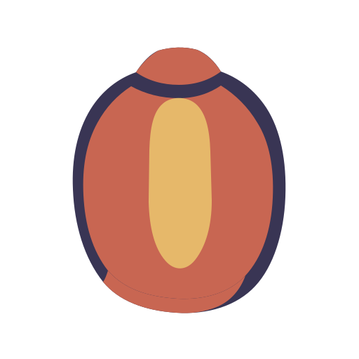

<div align="center">
  
  <h1>Marla</h1>
  <p><strong>翻译，就在你正在阅读的内容旁。</strong></p>
  <p>原生 macOS 翻译层，按需出现，贴近原文，读完即走。</p>
  <p>在原文旁点亮翻译，不把你带离当前工作。</p>

  <p>
    <a href="README.zh-CN.md">简体中文</a> ·
    <a href="README.md">English</a> ·
    <a href="README.ja.md">日本語</a> ·
    <a href="README.fr.md">Français</a> ·
    <a href="README.es.md">Español</a> ·
    <a href="README.de.md">Deutsch</a> ·
    <a href="README.ko.md">한국어</a>
  </p>

  <p>
    
    
    
    
  </p>

  <p>
    <a href="website/">Marla 介绍主页</a> ·
    <a href="https://github.com/Anti2077/Marla/releases/latest">下载（GitHub Releases）</a> ·
    <a href="https://github.com/Anti2077/Marla">GitHub</a>
  </p>

  <p>
    <a href="#为什么选择-marla">为什么选择 Marla</a> ·
    <a href="#三种日常用法">使用方式</a> ·
    <a href="#说清楚的隐私边界">隐私</a> ·
    <a href="#开发">开发</a> ·
    <a href="docs/README.md">文档</a>
  </p>
</div>

<p align="center">
  <strong><a href="website/public/media/desktop/marla-hero-in-place--desktop-5x4.mp4">观看 Marla 真实操作演示（MP4）</a></strong>
</p>

<p align="center"><sub>原生 macOS 应用实录，GitHub 将在媒体查看器中打开 MP4。</sub></p>

## 从这里开始

Marla 的介绍主页在 [`website/`](website/)；准备下载时前往 [GitHub Releases](https://github.com/Anti2077/Marla/releases/latest)，源代码和开发记录在 [GitHub 仓库](https://github.com/Anti2077/Marla)。当前仓库仍处于发布前准备阶段，Releases 页面可能尚未有可下载资产。

## 为什么选择 Marla

多数翻译工具会让你切换到另一个地方。Marla 以你当前使用的应用为主要界面：快捷键唤起，在原文附近阅读结果，关闭后继续原来的工作。

- **留在原处。** 划词和普通截图的翻译结果显示在附近的原生卡片中。
- **立即回应操作。** 稳定的结果界面先于网络响应出现，并随流式内容逐渐展开。
- **保留结构。** 快速输入和受支持的富文本选择在翻译及原生显示中保留语义化 Markdown。
- **服务可替换。** 命名配置支持 OpenAI 兼容 Chat Completions、OpenAI Responses、Anthropic Messages 和 Google Gemini Generate Content，端点和模型由用户明确选择。

## 三种日常用法

| 入口 | 默认快捷键 | 工作方式 |
| --- | --- | --- |
| **选中文本** | `⌃⇧D` | 安全取得当前选中文本，在原文旁流式显示翻译。 |
| **屏幕区域** | `⌃⇧S` | 各显示器的冻结画面支持区域、元素和窗口选择。默认使用 Vision OCR，也可明确选择云端 GLM-OCR 或本机 Ollama `glm-ocr`。 |
| **快速输入** | `⌃⇧Space` | 在紧凑编辑器中翻译输入或粘贴的内容，保留受支持的 Markdown 结构。 |

**可选实验功能：** 独立的原位截图翻译默认关闭，可从实验室设置启用。默认快捷键为 `⌃⇧I`，可以修改。它使用云端 GLM-OCR，仅在选中区域的冻结画面上重建可靠的文字块，全程保留在内存中，可立即关闭。普通截图翻译仍使用附近的结果卡片。

快捷键均可自定义。完成后的结果支持对照、复制、重试、系统朗读、固定、切换语言和翻译服务配置，保持轻量的翻译体验。

## 关键体验保持原生

```text
用户明确触发
  → SwiftUI / AppKit 获取内容并呈现界面
  → 进程内版本化 C ABI
  → 嵌入式 Rust 核心负责服务适配、流式响应、归一化与取消
  → 原文附近的原生结果界面
```

Marla 使用 Swift 6 开发 macOS 应用，以 SwiftUI 构建持久界面，以 AppKit 处理菜单栏、面板、焦点和屏幕交互。Rust 2024 核心以静态库嵌入，没有由 Marla 启动的本机后端或独立常驻服务。

## 说清楚的隐私边界

| 路径 | 当前边界 |
| --- | --- |
| **划词翻译** | 仅通过用户明确触发的受保护复制事务取得内容。辅助功能用于权限和定位，不作为隐藏的文本来源。 |
| **Vision 截图 OCR** | 选中区域的截图保留在本机进行 OCR；后续文字翻译仍可能使用已配置的云端服务。 |
| **云端 GLM-OCR** | 仅在用户阅读设置中的说明并明确选择后，或主动调用已启用的原位实验功能时，上传选中区域。 |
| **本机 Ollama GLM-OCR** | 选中区域仅发送到用户管理的本机 Ollama `glm-ocr` 服务。Marla 不捆绑、安装或启动 Ollama 及其模型；后续文字翻译仍可能使用云端服务。 |
| **存储** | 截图和最近翻译仅保留在内存中，凭据存储在钥匙串中。尚未实现持久翻译历史或上下文窗口文本采集。 |

Marla 不宣称完全离线。翻译服务、OCR 和数据流的具体边界会明确呈现。

## 支持语言

Marla 当前提供七种产品语言选项：

| 语言 | 代码 |
| --- | --- |
| 简体中文 | `zh-Hans` |
| 英语 | `en` |
| 日语 | `ja` |
| 法语 | `fr` |
| 西班牙语 | `es` |
| 德语 | `de` |
| 韩语 | `ko` |

繁体中文归一化为简体中文产品选项，不设独立偏好。服务商文档可能列出更多语言；只有在检测、路由、界面和服务映射一并验证后，Marla 才会宣称支持相应产品语言。

## 项目状态

Marla 仍处于 **孵化中／尚未发布** 阶段，正在准备公共入口。原生应用及主要流程已实现，但尚未宣布公开发行版、指定产品版本、公证安装包或自动更新器。

- [已验证的开发状态](docs/development/STATUS.md)
- [产品定义](docs/product/PRODUCT.md)
- [架构](docs/architecture/ARCHITECTURE.md)
- [纸灯笼品牌](docs/product/BRAND.md)
- [Marla 介绍主页](website/)
- [网站实现说明](website/README.md)

## 致谢与借鉴

感谢开源项目 [Snow Shot](https://github.com/mg-chao/snow-apps)。Marla 的截图元素选择参考了它的元素吸附、滚轮切换父子层级、后台查询调度与可中断选框过渡设计，其流畅的交互体验为本功能提供了重要参考。

我们研究了 [Snow Shot 的固定源码版本](https://github.com/mg-chao/snow-apps/tree/01753292547704fd0f11c45317d2dd08cdbf03df)，并使用 Swift/AppKit 独立实现，未引入其源码或依赖。Marla 的移动后即时重新吸附、触控板单手势单层切换及动效时序结合本项目的实机反馈调整。实现与验证记录见 [TASK-054](docs/tasks/TASK-054-element-selection-motion.md)。

## 许可证

Marla 的原创代码、构建脚本、文档及原创项目资产，在所有者有权授权的范围内采用 **GNU GPL 第 3 版，仅此版本（`GPL-3.0-only`）**。详见 [许可证全文](LICENSE)、[版权声明](COPYRIGHT)、中英双语的[许可与对应源码分发指南](docs/development/LICENSING.md)和[第三方通知](THIRD_PARTY_NOTICES.md)。允许按 GPL 条件修改、再分发和商用，没有禁止商用限制。第三方内容保留原许可；官网 GSAP 依赖存在未解决的 GPL 兼容性冲突，本授权不重许可这些依赖，也不宣称组合官网构建完全兼容 GPL。

## 开发

### 环境要求

- Apple Silicon 上的 macOS 14 或更高版本
- Xcode 26.5 或兼容的完整 Xcode 安装
- Swift 6.2 或更高版本
- Rust 1.85 或更高版本

运行完整仓库检查：

```sh
./scripts/check.sh
```

脚本检查 Rust 格式，构建和测试 Rust 核心与 Swift 层，使用 Cargo 调试库构建原生 Debug 应用，并检查项目结构和差异。它仅为自身命令选择完整 Xcode，不改变系统级 `xcode-select` 设置。

构建固定路径、稳定签名的 Release 开发应用：

```sh
./scripts/build-test-app.sh
```

验证后的应用输出到 `artifacts/Marla_dev.app`，使用开发专用的营销版本号 `0.0.0`。该数字仅是应用包元数据，不是公开发行版本。

<details>
<summary><strong>首次本机签名构建</strong></summary>

打包脚本要求稳定的本机代码签名身份，不会静默回退到临时签名。将 `security find-identity -v -p codesigning` 列出的身份名称或证书哈希传入：

```sh
MARLA_CODE_SIGN_IDENTITY="Your Local Code Signing Identity" \
./scripts/build-test-app.sh
```

后续无参数构建会从现有固定应用取得证书哈希，并在替换前检查签名指定要求保持稳定。这仅用于本机测试，不提供 Developer ID 分发、公证或自动 TCC 授权。

</details>

### 仓库结构

| 路径 | 职责 |
| --- | --- |
| `Sources/MarlaApp/` | SwiftUI/AppKit 应用、内容获取、设置、会话和呈现 |
| `Sources/MarlaCore/` | 面向 Swift 的桥接模型与服务契约 |
| `Sources/MarlaRustFFI/` | Swift 与 Rust 之间的版本化 C 桥接 |
| `rust/marla-core/` | 嵌入式服务适配、流式响应、OCR 归一化与取消核心 |
| `website/` | 独立的 React/Vite 产品介绍主页原型 |
| `docs/` | 产品事实、架构、Task、状态与验证证据 |
| `scripts/` | 仓库检查、打包与应用产物验证 |

修改前先阅读[文档地图](docs/README.md)、[当前状态](docs/development/STATUS.md)，以及明确分配给当前对话／工作树的 Task。本仓库分别管理产品想法、已确认待办、当前实施和已验证证据。

---

<p align="center"><sub>纸灯笼：阅读者身旁的一点微光。</sub></p>
